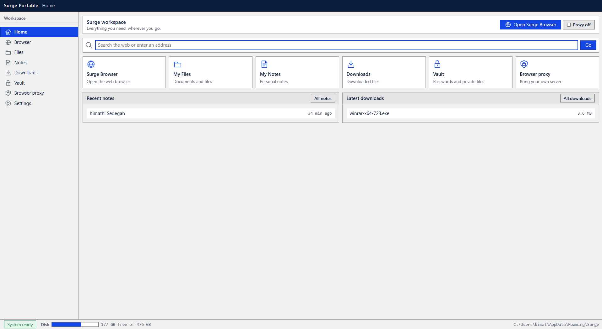
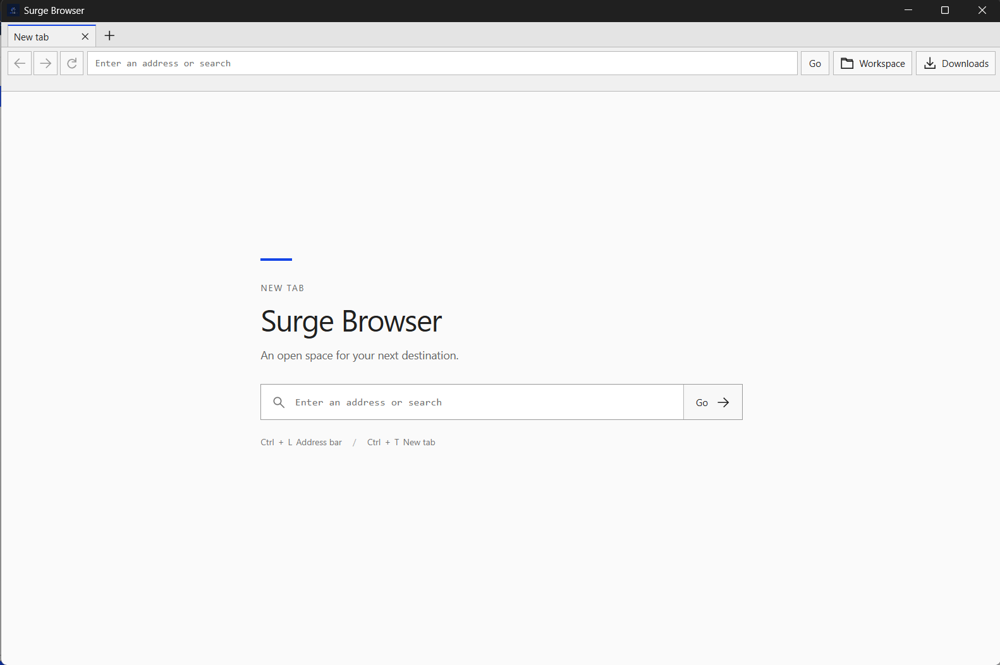

# Surge Workspace & Browser

Your browser and your personal workspace, together on one USB drive or installed on your computer.

Plug the drive into any Windows computer, open **Surge.exe**, and you have a full workspace with a private browser, encrypted password vault, notes, file manager, and proxy protection. Nothing is installed on the computer, no admin rights are needed, and no account or sign-in is required.

Unplug the drive and everything goes with you.

---

## What You Get

| | |
| --- | --- |
| **Surge Browser** | A private browser with tabs, isolated profiles, and all your browsing data stored on your drive |
| **Encrypted Vault** | A locked password manager and private file vault, protected by a master password you choose |
| **Fingerprint Unlock** | Optionally unlock your vault with your fingerprint or Windows Hello (desktop install only) |
| **Browser Proxy** | Route your browsing through your own proxy server, with an automatic kill switch if the connection drops |
| **My Files** | Browse and organise the files on your drive |
| **My Notes** | Write notes that save themselves, even with no internet |
| **Downloads** | Everything you download lands on the drive, in one place |
| **Settings** | Pick your theme, search engine, and privacy timings |

---

## Two Ways to Use Surge

### Portable (USB Drive)

Download **SurgeOS-Portable.iso**, copy it to a USB drive, and run `Surge.exe`. Everything lives on the drive — your data, your browser, and the app itself. No installation, no registry entries, no traces left behind.

### Desktop (Windows Installer)

Run **Surge-Setup.exe** to install Surge on your computer. The desktop version adds fingerprint unlock, desktop and Start Menu shortcuts, and a standard uninstaller in Windows Settings.

Both versions work fully offline. You only need the internet to visit websites.

---

## Getting Started

### From a USB Drive

1. Copy the contents of the ISO to a USB drive.
2. Open the drive and double-click **Surge.exe**.
3. Start from the home screen and navigate with the sidebar.

### From the Installer

1. Run **Surge-Setup.exe** and follow the steps.
2. Launch Surge from your Desktop or Start Menu.

When you're finished, close Surge and safely eject the drive before unplugging.

---

## Good to Know

- **Your master password cannot be recovered.** Surge never stores it anywhere. If you forget it, the passwords in the vault are gone for good. Write it down and keep it somewhere safe.
- **The vault locks itself** after a few minutes of inactivity, and whenever you leave the Vault tab or close Surge. You can also lock it manually at any time.
- **The proxy is browser-only.** It covers the Surge browser, not other apps on the computer. Surge does not bundle a proxy provider or promise anonymity.
- **Keep some free space.** Surge warns you when the drive is running low.
- **Surge stays on the drive.** In portable mode, it does not write files to the host computer.
- **System files are hidden.** The file manager only shows your personal documents and downloads — not the files that run the app.

---

## Privacy

Surge keeps your things on the USB drive (or your install folder) rather than scattering them across the computer. Nothing is sent to any cloud service. There is no account, no sync, and no telemetry.

It is **not** a way to browse invisibly. The computer, its antivirus software, and the websites you visit can still leave traces, and your internet provider can still see your traffic.

---

## Requirements

- Windows 10 or Windows 11
- About 500 MB of free space
- No admin rights needed
- Nothing else to install — Surge is fully self-contained

---

## Release Policy

Only fully tested, production-ready builds are published. No betas or previews. Each release includes official release notes and is available on the [GitHub Releases page](https://github.com/sedegah/SurgeOS/releases).

---

## Not Included

By design, Surge has no cloud sync, email client, AI assistant, app store, or built-in VPN. It is a portable workspace and browser, not an operating system.
